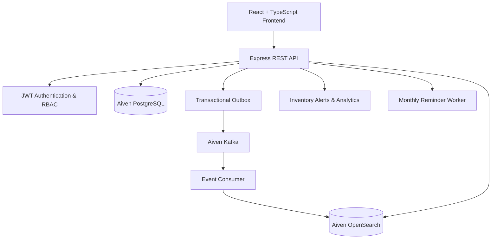

# 🐝 HiveMart
### Your City. Your Cart. Your Hive.

**A Smart Omnichannel Retail & E-Commerce Platform**

HiveMart connects online shopping and physical retail through a centralized, city-wise inventory system. Built for a retail business expanding into digital commerce, HiveMart brings customers, retailers, and administrators together in one intelligent platform.

**36 Products · 5 Cities · 3 User Roles · Real-Time Inventory Synchronization**

[](https://hive-mart.vercel.app)
[](https://hivemart-backend.onrender.com/api/health)


---

## 🌐 Live Demo

**Frontend:** https://hive-mart.vercel.app

**Backend Health Check:** https://hivemart-backend.onrender.com/api/health

**GitHub Repository:** https://github.com/mounika889/HiveMart

> HiveMart is deployed with its frontend on Vercel and backend on Render, using Aiven-managed cloud infrastructure.

---

## 🎯 Problem Statement

Traditional retail businesses face several challenges when expanding into online commerce:

- Maintaining accurate stock across online and physical sales.
- Preventing overselling when multiple customers purchase simultaneously.
- Managing inventory across different cities.
- Identifying high-demand products before they run out.
- Providing customers with convenient recurring shopping experiences.

### 💡 Our Solution

HiveMart provides an integrated omnichannel retail system with a **single authoritative inventory source for each city**.

Every completed online checkout or finalized offline retailer bill updates the corresponding city's warehouse inventory through database transactions.

Smart alerts, sales analytics, and personalized shopping reminders make the platform more than a conventional online store.

---

## ✨ Key Features

### 🛒 Customer Experience

- Browse products by category and city.
- Search products using intelligent search capabilities.
- View city-specific product availability.
- Add, update, and remove cart items.
- Complete orders using stock-safe checkout.
- View order history and order details.
- Create personalized Monthly Essentials shopping lists.
- Receive recurring shopping reminders.
- Add monthly essentials to the cart with one click.

### 🏪 Retailer Experience

- Dedicated retailer authentication and dashboard.
- City-assigned warehouse inventory visibility.
- Offline point-of-sale billing terminal.
- Draft, finalize, and review customer bills.
- Automatic stock deduction after bill finalization.
- Printable sales receipts.
- Low-stock and critical-stock notifications.
- Monthly bestseller insights and demand forecasting.
- Retailer notification center with read and acknowledgment actions.

### 🛡️ Admin Experience

- Role-based access management.
- Retailer onboarding, approval, and suspension.
- City assignment and retailer governance.
- Multi-city inventory monitoring.
- Stock threshold configuration.
- Cross-city bestseller analytics.
- Order and offline sales visibility.
- Centralized operational dashboard.

---

## 🧠 What Makes HiveMart Different?

| Innovation | How It Works |
|---|---|
| Centralized City Warehouses | Online and offline sales share the same authoritative city inventory |
| Atomic Checkout | PostgreSQL row locks prevent simultaneous purchases from overselling stock |
| Offline POS Integration | Finalized retailer bills immediately deduct stock from the assigned city warehouse |
| Event-Driven Synchronization | Kafka and the transactional outbox propagate inventory and order events |
| Intelligent Search | OpenSearch powers product discovery and search |
| Smart Stock Alerts | Retailers receive early-warning, low-stock, critical, and out-of-stock notifications |
| Bestseller Demand Analytics | Monthly sales velocity helps identify products that may need early replenishment |
| Monthly Essentials | Customers maintain recurring shopping lists and receive scheduled reminders |
| Role-Based Security | Customer, Retailer, and Admin operations are protected by authorization rules |

---

## 🏗️ System Architecture



### 🔄 Inventory Synchronization

**Online Purchase**

Customer → Cart → Checkout → PostgreSQL Transaction → Warehouse Stock Deduction → Outbox Event → Kafka → OpenSearch

**Offline Retail Sale**

Retailer → POS Terminal → Draft Bill → Finalize Bill → PostgreSQL Transaction → Warehouse Stock Deduction → Outbox Event → Kafka → OpenSearch

Both flows operate against the same city-level inventory records.

---

## 🛠️ Technology Stack

| Layer | Technologies |
|---|---|
| Frontend | React, TypeScript, Vite, Tailwind CSS |
| Backend | Node.js, Express.js |
| Database | PostgreSQL |
| Cloud Database | Aiven PostgreSQL |
| Event Streaming | Apache Kafka, Aiven Kafka |
| Search Engine | OpenSearch, Aiven OpenSearch |
| Authentication | JWT, bcrypt, Role-Based Access Control |
| Testing | Automated Integration Tests, Playwright |
| Frontend Hosting | Vercel |
| Backend Hosting | Render |
| Version Control | Git, GitHub |

---

## 👥 Three Dedicated User Roles

### Customer
Explore products, manage carts, place orders, track order history, and maintain recurring monthly shopping lists.

### Retailer
Manage offline billing, monitor assigned city inventory, review sales, and receive stock replenishment notifications.

### Admin
Manage retailers, monitor inventory across cities, configure stock thresholds, and analyze omnichannel sales performance.

---

## 🌆 Multi-City Inventory

HiveMart currently supports five Indian metropolitan warehouse hubs:

- Bengaluru
- Hyderabad
- Chennai
- Mumbai
- Delhi

The initial catalog contains **36 active products and 180 city-wise inventory records**.

Each city's stock is maintained independently, while online and offline sales within that city share the same warehouse inventory.

---

## 📊 Smart Inventory Notifications

HiveMart classifies warehouse stock into multiple alert levels:

| Stock Level | Default Threshold | Alert |
|---|---|---|
| Healthy | Above 20 units | No warning |
| Reorder Soon | 20 units or below | Early replenishment |
| Low Stock | 10 units or below | Warning |
| Critical Stock | 5 units or below | Critical |
| Out of Stock | 0 units | Urgent |

Administrators can configure inventory thresholds.

For monthly bestsellers, the analytics engine also estimates demand using sales velocity and remaining stock coverage.

**Estimated Stock Coverage = Current Stock ÷ Average Daily Units Sold**

This helps retailers identify fast-selling products before they become unavailable.

---

## 📅 My Monthly Essentials

Customers can build reusable monthly shopping lists for everyday products.

For example:

| Product | Monthly Quantity |
|---|---:|
| Oats | 2 |
| Bread | 4 |
| Soup | 3 |
| Milk | 6 |

Customers can configure a preferred shopping day and reminder schedule.

When a reminder arrives, they can add their saved essentials to the existing cart, review current prices and stock, and proceed through the normal checkout flow.

**No automatic purchase is made without customer action.**

---

## 🔐 Security & Reliability

HiveMart incorporates several safeguards:

- JWT-based authentication.
- Password hashing with bcrypt.
- Customer, Retailer, and Admin role authorization.
- Retailer approval and account status verification.
- PostgreSQL transactional inventory updates.
- Row-level locking for concurrent sales.
- Idempotent checkout and POS finalization.
- Transactional outbox for reliable event publication.
- Duplicate-event handling for search synchronization.
- Customer-specific resource ownership checks.
- Stock validation to prevent negative inventory.

---

## 📁 Project Structure

```text
HiveMart/
├── backend/
│   ├── src/
│   │   ├── routes/
│   │   ├── services/
│   │   ├── workers/
│   │   └── ...
│   ├── package.json
│   └── ...
├── frontend/
│   ├── src/
│   │   ├── components/
│   │   ├── pages/
│   │   └── ...
│   ├── package.json
│   └── vercel.json
├── README.md
└── ...
```

---

## 🚀 Run Locally

### Prerequisites

- Node.js and npm
- PostgreSQL database connection
- Required backend environment variables
- Kafka and OpenSearch configuration for their respective integrations

### 1. Clone the Repository

```bash
git clone https://github.com/mounika889/HiveMart.git
cd HiveMart
```

### 2. Start the Backend

```bash
cd backend
npm install
npm run dev
```

Backend runs locally at:

`http://localhost:5000`

### 3. Start the Frontend

Open another terminal:

```bash
cd frontend
npm install
npm run dev
```

Open the local URL printed by Vite.

### 4. Configure Environment Variables

Set the required environment variables using the backend's configuration documentation.

Do not commit `.env` files, database credentials, JWT secrets, or cloud service credentials to GitHub.

---

## 🧪 Testing & Quality Assurance

HiveMart underwent automated verification across authentication, checkout, offline POS billing, concurrency, inventory safety, and customer shopping workflows.

**Sprint 9J reported verification results:**

| Test Category | Reported Result |
|---|---|
| Cumulative Regression Assertions | 621 passed |
| Playwright Browser E2E | 21 passed |
| Production Frontend Build | Successful |
| Negative Inventory Checks | 0 negative rows |
| Online vs Offline Stock Race | Verified |
| JWT and Role Authorization | Verified |

These figures reflect the Sprint 9J pre-deployment verification report.

---

## 📸 Application Screenshots

Add screenshots to an `assets/screenshots/` directory and include them here:

- Homepage and product discovery
- Customer shopping cart and checkout
- Retailer POS terminal
- Retailer inventory notification dashboard
- Admin management dashboard
- Monthly Essentials page

---

## 🔮 Future Enhancements

- Expanded product catalog and warehouse coverage.
- Advanced demand forecasting.
- Supplier and procurement integrations.
- Customer delivery tracking after logistics integration.
- Payment gateway integration.
- Richer business intelligence dashboards.
- Mobile application support.

---

## 🏆 Hackathon Project

HiveMart was developed as a hackathon solution for a retail chain transitioning from traditional physical stores to an integrated digital and omnichannel shopping platform.

The project emphasizes **inventory correctness, reliable transactions, accessible shopping experiences, and scalable cloud architecture**.

---

## 👩‍💻 Developer

**Gundubogula Mounika**

B.Tech — Artificial Intelligence & Machine Learning  
Aditya University

**GitHub:** [@mounika889](https://github.com/mounika889)

---

## ⭐ Support the Project

If you find HiveMart interesting, consider giving the repository a ⭐ on GitHub.

**🐝 HiveMart — Your City. Your Cart. Your Hive.**
