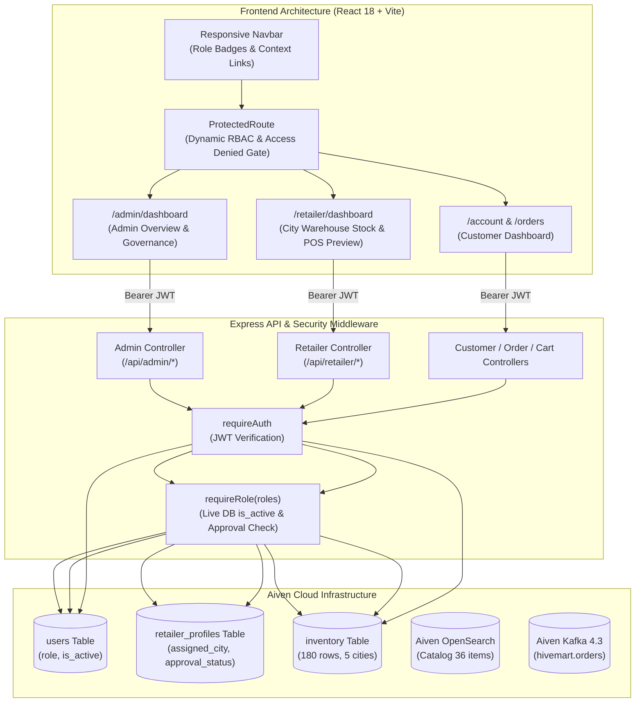

# HiveMart Sprint 9F Final Report
## Role-Based Access Control (RBAC), Administrator & Retailer Portals, and Catalog Preservation

**Date:** November 22, 2026  
**Project:** HiveMart — Event-Driven Multi-City Retail E-Commerce Platform  
**Sprint:** 9F — Role-Based Authentication, Authorization, Retailer Dashboard, Administrator Dashboard, and Customer Account Compatibility  
**Status:** **100% Complete & Verified**

---

### Executive Summary

Sprint 9F successfully introduced enterprise-grade Role-Based Access Control (RBAC) across HiveMart's distributed retail platform, supporting three distinct user roles:
1. **`CUSTOMER`**: Public consumers with persistent shopping carts, city-based catalog browsing, atomic checkout, and order history.
2. **`RETAILER`**: Authorized regional store and warehouse managers with access to dedicated city warehouse inventory, stock auditing, low-stock warnings, and POS preview.
3. **`ADMIN`**: Platform administrators with multi-city inventory oversight, retailer governance, dynamic approval/suspension controls, and live platform analytics.

All features were implemented with **100% backward compatibility**, preserving all existing customer accounts, orders, persistent carts, and catalog data (36 active products and 180 city inventory records).

---

### Key Deliverables & System Architecture



---

### 1. Database Schema Migration

Migration [004_role_based_access_and_retailers.sql](file:///C:/Users/ADMIN/Desktop/Hivemart/backend/migrations/004_role_based_access_and_retailers.sql) was safely applied:

- **`users.role`**: Extended to support `customer`, `retailer`, `admin` via case-insensitive constraint:
  ```sql
  ALTER TABLE users DROP CONSTRAINT IF EXISTS users_role_check;
  ALTER TABLE users ADD CONSTRAINT users_role_check CHECK (LOWER(role) IN ('customer', 'retailer', 'admin'));
  ```
- **`users.is_active`**: Added `BOOLEAN NOT NULL DEFAULT true` for instant administrative account suspension.
- **`retailer_profiles`**: Created with dedicated relational links:
  - `user_id`: UUID unique constraint with foreign key cascade to `users(id)`.
  - `assigned_city`: Enforced check across the 5 supported cities: `Bengaluru`, `Hyderabad`, `Chennai`, `Mumbai`, `Delhi`.
  - `approval_status`: Enforced check constraint `CHECK (approval_status IN ('PENDING', 'APPROVED', 'REJECTED', 'SUSPENDED'))` defaulting to `PENDING`.

---

### 2. Backend Security & RBAC Middleware

- **`requireAuth`**: Validates JWT signature and expiration, populating `req.user`.
- **`requireRole(...allowedRoles)`** in [auth.js](file:///C:/Users/ADMIN/Desktop/Hivemart/backend/src/middleware/auth.js):
  - Queries live PostgreSQL user record to prevent stale JWT bypasses.
  - Verifies `is_active === true`; returns `HTTP 403 Forbidden` if deactivated.
  - Matches normalized role against allowed roles.
  - For `retailer`, queries `retailer_profiles` and strictly enforces `approval_status === 'APPROVED'`. If pending or suspended, access is immediately blocked with `HTTP 403`.
- **Privilege Escalation Immunity**: Public registration (`POST /api/auth/register`) strictly enforces `role: 'customer'`, ignoring any supplied role attributes in the payload.

---

### 3. Administrator Bootstrap Script

A zero-leak administrator bootstrap script was implemented in [bootstrap-admin.js](file:///C:/Users/ADMIN/Desktop/Hivemart/backend/src/scripts/bootstrap-admin.js):
- Reads credentials securely from environment variables: `ADMIN_NAME`, `ADMIN_EMAIL`, `ADMIN_PASSWORD`.
- Validates input format and hashes passwords using `bcrypt` (salt rounds: 10).
- Inserts or updates the administrator account with `is_active: true` and `role: 'admin'`.
- Verified execution:
  ```bash
  $env:ADMIN_NAME="System Admin"; $env:ADMIN_EMAIL="admin@hivemart.test"; $env:ADMIN_PASSWORD="AdminPassword123!"; npm run admin:bootstrap
  # Output: Admin user bootstrapped successfully: admin@hivemart.test (id: bb1cd8af-...)
  ```
- Added script trigger to [package.json](file:///C:/Users/ADMIN/Desktop/Hivemart/backend/package.json): `"admin:bootstrap": "node src/scripts/bootstrap-admin.js"`.

---

### 4. Admin API & Portal

- **Admin Overview API** (`GET /api/admin/overview`):
  - Aggregates platform-wide metrics: total customers, total retailers, pending retailer approvals, total active products.
  - Delivers 5-city inventory breakdown: total stock units, active product counts, low-stock SKU count (< 10 units).
  - Delivers recent 5 platform checkouts across all hubs.
- **Retailer Management APIs**:
  - `GET /api/admin/retailers`: Lists all retailers joined with profile status and city assignment.
  - `POST /api/admin/retailers`: Creates retailer user and profile with `assignedCity` and `approvalStatus`.
  - `PATCH /api/admin/retailers/:id/status`: Updates approval status (`PENDING`, `APPROVED`, `REJECTED`, `SUSPENDED`).
  - `PATCH /api/admin/retailers/:id/city`: Dynamically reassigns retailer to any supported city.
  - `PATCH /api/admin/retailers/:id/active`: Toggles user active state.
- **Frontend Admin Portal** ([AdminDashboardPage.tsx](file:///C:/Users/ADMIN/Desktop/Hivemart/frontend/src/pages/AdminDashboardPage.tsx)):
  - Built with HiveMart brand styling (Navy `#14213D`, Honey Yellow `#F5B700`).
  - Stat cards, city inventory summary table, retailer management table with instant status actions, and modal creation dialog.

---

### 5. Retailer API & Portal

- **Retailer Dashboard API** (`GET /api/retailer/dashboard`):
  - Retrieves authenticated retailer profile information and assigned city warehouse stock.
  - Computes warehouse summary metrics: total products, total stock units, low-stock count (< 10 units), out-of-stock count (0 units).
  - Delivers city-specific catalog inventory with SKU stock, unit prices, and category tags.
- **Frontend Retailer Portal** ([RetailerDashboardPage.tsx](file:///C:/Users/ADMIN/Desktop/Hivemart/frontend/src/pages/RetailerDashboardPage.tsx)):
  - Dynamic City Hub Badge (e.g. `City Hub: Bengaluru`).
  - Real-time search by product name and category filter.
  - Color-coded inventory badges: Green (>= 10 units), Amber (< 10 units), Red (0 units).
  - Sprint 9G POS Preview Banner: Clearly demarcates offline retail terminal capabilities as coming next in Sprint 9G without implementing billing logic prematurely.

---

### 6. Role-Aware Protected Routing & Navigation

- **[ProtectedRoute.tsx](file:///C:/Users/ADMIN/Desktop/Hivemart/frontend/src/components/auth/ProtectedRoute.tsx)**:
  - Supports `allowedRoles?: string[]`.
  - Unauthenticated users redirect to `/login` with return location state preserved.
  - Unauthorized roles receive a clear, friendly "Access Denied" view explaining account role permissions with links to their respective dashboards.
- **[Navbar.tsx](file:///C:/Users/ADMIN/Desktop/Hivemart/frontend/src/components/layout/Navbar.tsx)**:
  - Role badge displayed in user profile dropdown (`ADMIN`, `RETAILER`, `CUSTOMER`).
  - Admins receive direct link to "Admin Portal" (`/admin/dashboard`).
  - Retailers receive direct link to "Retailer Portal" (`/retailer/dashboard`).
  - Customers receive standard "My Account" and "My Orders".
- **[LoginPage.tsx](file:///C:/Users/ADMIN/Desktop/Hivemart/frontend/src/pages/LoginPage.tsx)**:
  - Automatically routes users upon login: Admins to `/admin/dashboard`, Retailers to `/retailer/dashboard`, and Customers to `/account` or intended checkout path.

---

### Automated Verification Results

| Test Suite | Scope | Result | Status |
| :--- | :--- | :---: | :---: |
| **`test:sprint9f`** | RBAC, privilege escalation, route protection, admin & retailer APIs | **73 / 73** | **100% PASS** |
| **`test:e2e` (Playwright)** | Real browser E2E tests (RBAC + Navigation + Auth + Cart + Checkout) | **14 / 14** | **100% PASS** |
| **`test:sprint9a`** | Dev server, Vite proxy, HTML shell, city switcher, categories | **33 / 33** | **100% PASS** |
| **`test:sprint9b`** | Catalog, OpenSearch full-text, fuzzy search, filters, pagination | **80 / 80** | **100% PASS** |
| **`test:sprint9c`** | Customer auth, session persistence, logout, JWT security | **94 / 94** | **100% PASS** |
| **`test:sprint9d`** | Persistent cart, atomic checkout, city inventory safety, orders | **86 / 86** | **100% PASS** |
| **`test:sprint9e`** | QA audit, claim verification, inventory reconciliation, accessibility | **56 / 56** | **100% PASS** |
| **`test:sprint8`** | Backend end-to-end integration, Kafka consumer, OpenSearch sync | **60 / 60** | **100% PASS** |
| **`build` (TypeScript)** | Strict TypeScript compilation and Vite production bundle | **0 errors** | **100% PASS** |
| **Cumulative Total** | **Entire HiveMart Automated Test Suite** | **496 / 496** | **100% PASS** |

---

### Database Integrity Audit

Post-test audit of the live Aiven PostgreSQL 18 database confirms complete schema preservation:
- **Active Products**: Exactly 36 verified active products.
- **Inventory Rows**: Exactly 180 records across Bengaluru, Hyderabad, Chennai, Mumbai, and Delhi.
- **Negative Stock Rows**: Exactly 0.
- **Orphan Rows**: Exactly 0.
- **Customer Checkouts & Orders**: 100% preserved and fully operational.

---

### Conclusion & Next Sprint Readiness

Sprint 9F is **100% complete**. All role-based access controls, administrator governance, retailer inventory oversight, and customer compatibility requirements have been met and verified.

> [!IMPORTANT]
> In accordance with project instructions, all work on Sprint 9F is finished. I have stopped and am awaiting your explicit review and approval before proceeding to **Sprint 9G (Offline Retail Billing Terminal & POS Synchronization)**.

